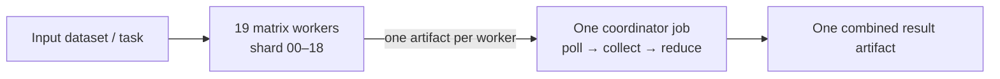

# Nexus Training Framework (NTF)

**A reusable GitHub Actions fan-out/fan-in starter:** 19 independent workers and one coordinator, with a live run monitor and a domain-specific reducer.

NTF is a framework pattern, not a claim that GitHub Actions is a GPU cluster or that arbitrary model weights can be merged. The included demo shards a tiny JSONL file, counts words on 19 workers, waits for all worker jobs through GitHub's Actions API, downloads their artifacts, and sums the results.

## The 19–1 idea



- **Workers:** one matrix job for each shard ID `00` through `18`. `fail-fast: false` lets every shard finish even if one fails.
- **Coordinator:** one separate job starts alongside the matrix when runner capacity permits. It polls the current workflow run, waits for all 19 named workers to finish, then downloads and reduces their artifacts.
- **Concurrency:** `max-parallel: 19` caps the worker matrix. With an available 20-job account limit, 19 workers plus the coordinator can occupy 20 runner slots; Actions may queue jobs when the repository/account is at its limit or another workflow is using capacity.
- **Data handoff:** GitHub-hosted jobs have separate ephemeral workspaces. Workers do not share a disk; outputs are uploaded and later downloaded as workflow artifacts.

The coordinator is a **job that monitors worker job states**, not a permanent service. The sample uses `GITHUB_TOKEN` with read-only Actions permission and polls once per minute. If you do not need live polling, a simpler coordinator with `needs: worker` can start after the matrix finishes; this starter deliberately demonstrates the 19-worker/1-monitor shape.

## Quick start

1. Copy this repository into your project or download/unzip the archive.
2. Commit the files to a GitHub repository. Enable Actions if it is disabled.
3. Open **Actions → NTF 19-worker demo → Run workflow**. The sample is manual-triggered to avoid unexpectedly starting 20 jobs on every push.
4. Open the run. The **NTF coordinator / live monitor + reducer** job reports worker progress. On success, download `ntf-final-report` and inspect `summary.json`.
5. Read [`skills/ntf-adapter/SKILL.md`](skills/ntf-adapter/SKILL.md) and [`docs/adapting.md`](docs/adapting.md) before adapting it.

No third-party service, paid credential, or dependency is needed for the toy demo. The Python scripts use only the standard library.

## Adapt it to another workflow

The reusable boundary is intentionally small:

1. **Partition:** choose a stable shard assignment in your worker or data adapter. Every work item must be assigned exactly once (or intentionally replicated).
2. **Worker:** replace `scripts/demo_worker.py` with your project command. It receives a shard ID and total shard count and writes a small, versioned result under `out/`.
3. **Artifact:** retain one uniquely named artifact per shard, or change the upload/download strategy if outputs are large.
4. **Reducer:** replace `scripts/reduce.py` with the correct, deterministic domain operation: combine metrics, concatenate independent outputs, select the best candidate, or run an explicitly justified ML aggregation algorithm.
5. **Validate:** test missing, duplicate, malformed, and failed shard outputs before using results downstream.

The demo uses round-robin JSONL **records** (`line_number % 19`), which is balanced by record count only. It reads the small checked-in demo file on every worker. For a large dataset, don't copy that behavior blindly: put the data in suitable storage and make each worker retrieve only its assigned shard or partition, preferably from a precomputed manifest/object layout. NTF does not upload or split a 1 GB dataset for you.

## Model-training truth-in-advertising

The included reducer merges **word-count maps**, not model weights. Two independently trained checkpoints are not automatically compatible merely because they have the same filename or architecture. A valid model aggregator needs, at minimum, compatible tensor names/shapes, the same agreed initialization/protocol, and an algorithm whose assumptions fit the training procedure and data. Federated averaging is one possible protocol for compatible local updates; it is not a universal merge operation. Many frontier-model training methods require synchronized gradients, specialized accelerators, high-bandwidth communication, large storage, and continuous multi-node coordination that ordinary ephemeral Actions runners do not provide.

Treat this repository as a **general-purpose embarrassingly-parallel workflow scaffold**. For ML, use it only for work that is truly shardable (for example, preprocessing, evaluation, hyperparameter trials, or explicitly designed federated rounds) and implement/review the model-specific protocol separately. Do not publish or deploy aggregated weights without validating quality and provenance.

## LitGPT from-scratch training scaffold

The [`training/litgpt/`](training/litgpt/) subtree is an optional, explicitly invoked trainer based on [Lightning AI LitGPT](https://github.com/Lightning-AI/litgpt) (Apache-2.0). It uses the Pythia-14M architecture with randomly initialized weights and a tokenizer-only download; its checked-in data and 256-token budget are a tiny smoke example, not a useful language model. Read its setup and data guidance before starting a real run.

This trainer is **not** wired into GitHub Actions. The 19 independent matrix workers do not exchange synchronized gradients and cannot substitute for DDP/FSDP or a coordinated multi-node training system. Standard GitHub-hosted runners are resource/plan-limited; GPU/larger runners are separate, concurrency may queue, and each hosted job has a six-hour cap. See the [LitGPT trainer notes](training/litgpt/README.md) before choosing an actual training platform.

## GitHub Actions realities

These figures are not a promise of identical resources for every account or runner image:

- Current GitHub documentation lists **4 CPU / 16 GB RAM / 14 GB SSD** for standard Linux runners in **public** repositories; standard Linux runners for **private** repositories are listed as **2 CPU / 8 GB RAM / 14 GB SSD**. Larger/GPU runners are separate and plan-dependent.
- The documented standard hosted-job concurrency limit is plan-dependent. The current limits table lists 20 concurrent standard jobs for Free, 40 for Pro, 60 for Team, and higher limits for Enterprise; other workflows and account/organization policy also consume capacity. `max-parallel` is a ceiling, not a reservation.
- Each GitHub-hosted job can run for up to **6 hours**. The sample uses the normal 6-hour job timeout and the monitor gives itself a little margin; change that only with a deliberate runtime budget.
- Matrix jobs use separate VMs/workspaces. Artifacts are the data handoff, and large artifacts/datasets incur transfer time and storage/bandwidth costs. A 1 GB input downloaded by all 19 workers can mean roughly 19 GB of runner downloads, before output artifacts.
- Private repositories use included Actions minutes and then may incur charges. Check current usage and billing for your plan before increasing job count or runtime.

Check GitHub's latest limits and runner pages before relying on any capacity assumptions; they can change. Links are in [References](#references).

## Repository map

```text
.github/workflows/ntf.yml       19-worker + one live coordinator workflow
scripts/monitor.py              read-only polling of this run's worker jobs
scripts/demo_worker.py          tiny JSONL round-robin worker example
scripts/reduce.py               deterministic sum/reducer example
skills/ntf-adapter/SKILL.md     instructions for an AI agent adapting NTF
 docs/adapting.md                practical adaptation checklist
 tests/test_framework.py         offline unit tests
```

## Local test

```bash
python3 -m unittest discover -s tests -v
```

You can also run the demo end-to-end locally without GitHub:

```bash
rm -rf /tmp/ntf-demo && mkdir -p /tmp/ntf-demo/artifacts
for shard in $(seq -w 0 18); do
  python3 scripts/demo_worker.py --shard "$shard" --shards 19 --output-dir "/tmp/ntf-demo/artifacts/ntf-shard-$shard"
done
python3 scripts/reduce.py --input-dir /tmp/ntf-demo/artifacts --expected-shards 19 --output /tmp/ntf-demo/summary.json
cat /tmp/ntf-demo/summary.json
```

## References

- [GitHub Actions limits and concurrency](https://docs.github.com/en/actions/reference/limits)
- [GitHub-hosted runner hardware](https://docs.github.com/en/actions/reference/runners/github-hosted-runners)
- [Matrix jobs and `max-parallel`](https://docs.github.com/en/actions/writing-workflows/choosing-what-your-workflow-does/running-variations-of-jobs-in-a-workflow)
- [Store and share workflow artifacts](https://docs.github.com/en/actions/tutorials/store-and-share-data)
- [REST API: list jobs for a workflow run](https://docs.github.com/en/rest/actions/workflow-jobs)

## License

MIT. See [`LICENSE`](LICENSE).
