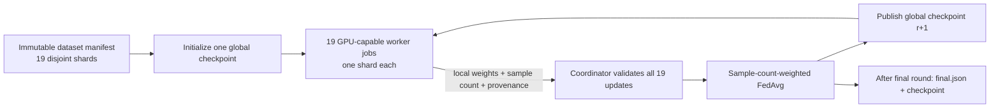

# Nexus Training Framework (NTF)

**Version 2.0.0 candidate — iterative 19-worker federated training scaffold.** NTF now provides a real, explicitly dispatched FedAvg training path: all workers share one Transformer architecture and each receives a different, checksummed data shard.

> **This repository contains training code and a reference configuration, not a trained or validated model.** No dataset is included, no training is launched by default, and the 14M-scale configuration is not a frontier model. Evaluate data rights, model quality, security, cost, and hardware before any production use.

## Protocol: one common checkpoint, one validated round at a time



For every round `r`:

1. All 19 workers load the **same** immutable global checkpoint `r` and verify its checksum, architecture, configuration, and manifest digest.
2. Each worker trains only its assigned data shard, using the same architecture, optimizer settings, and configured local-step budget. It reports the number of training sequences actually processed.
3. The coordinator waits for all 19 worker updates, rejects missing/duplicate/failed workers or incompatible metadata/tensors, and computes
   `global[r+1] = sum(n_i * local_weights_i) / sum(n_i)`.
4. It publishes the next checkpoint and only then can workers begin round `r+1`. Each worker creates a fresh local AdamW optimizer each round; optimizer state is not averaged.

This is **iterative federated averaging**, not naive averaging of independent full runs and not synchronized DDP/FSDP training. Every local update in a round must descend from the same global checkpoint. The coordinator validates exact tensor keys, shapes, floating dtypes, finite values, common parent checkpoint, config and data provenance, positive sample counts, and complete shard coverage.

## Architecture and reference configuration

- **Model:** `ntf-byte-gpt-14m-v1`, a decoder-only causal Transformer with byte-level UTF-8 token IDs, 6 layers, width 448, 7 attention heads, 256-token context, and approximately 14–15 million parameters.
- **Shared across workers:** model configuration, initialization, round count, local-step budget, optimizer settings, seed policy, software pins, and dataset-manifest digest. Only the assigned data shard and its deterministic worker/round seed differ.
- **Reference defaults:** 10 global rounds, up to 100 local optimizer steps per round, batch size 8. Change `training/fedavg/config.json` and workflow inputs to fit the corpus and hardware. More steps/rounds increase compute and storage; they are not a quality guarantee.
- **Determinism:** canonical config/manifest hashes and per-shard/per-round seeds are checked and recorded. Deterministic Torch algorithms are enabled; bitwise-identical outcomes across different GPU models, drivers, or kernel stacks are not promised. Keep worker software and accelerator environments aligned.
- **Checkpoint policy:** every run has a unique run prefix; round checkpoints and update artifacts are write-once, checksum-verified, and include parent/config/manifest/architecture metadata. Failed or incomplete rounds are not aggregated.

The FedAvg training implementation is the PyTorch engine in `training/fedavg/`; the older `training/litgpt/` folder remains only as a separate legacy smoke example and is not called by the production-oriented workflow.

## Hardware and 19 isolated runners

The workflow is manual-only (`workflow_dispatch`). There is no push, schedule, or automatic training trigger.

- Standard GitHub-hosted runner labels such as `ubuntu-latest` are **CPU-only**. The checked-in production config has `require_cuda: true`, so a CPU worker fails closed rather than silently starting a slow run. Set `worker_runner_json` to labels for 19 compatible GPU runners (for example `["self-hosted", "linux", "x64", "gpu"]`) or use a supported GPU runner offering. Confirm CUDA, driver, memory, disk, and installed PyTorch wheel compatibility on every worker.
- `coordinator_runner_json` is independently configurable; the coordinator can normally run on CPU. Runner labels select an eligible machine; they do not reserve capacity. Configure sufficient concurrency for **19 workers plus the coordinator and initializer**, accounting for other jobs and queued work.
- GitHub Actions jobs are isolated ephemeral environments. They do not share a local filesystem or GPU memory. NTF uses a private AWS S3 bucket for **round-by-round synchronization**: worker checkpoints/metadata are uploaded, the coordinator aggregates and publishes a new global checkpoint, and workers poll for it. GitHub artifacts alone arrive too late for this iterative barrier.
- Training can exceed hosted-runner time limits; each workflow job here has a six-hour timeout. For longer production runs, configure suitable self-hosted/hosted larger runners and tune limits accordingly. Review current platform, service, account concurrency, and billing policies before running.
- 19 workers do not become a multi-GPU collective. This design incurs checkpoint/data transfer and storage overhead. For workloads that need synchronized gradients, use a purpose-built DDP/FSDP or distributed training platform instead.

## Prepare data with provenance

The source corpus must be UTF-8 JSONL with unique `id` and non-empty `text` fields. Keep private/licensed corpora out of Git. The preparation tool partitions by the stable rule `SHA256(record_id) mod 19`, rejects duplicate IDs, proves every source row is written once, and emits checksums and provenance:

```bash
python3 scripts/prepare_shards.py \
  --input /secure/path/corpus.jsonl \
  --output-dir /secure/path/ntf-dataset \
  --dataset-id approved-corpus \
  --revision immutable-dataset-revision \
  --source 'internal registry record or source URL' \
  --license 'documented license/permission' \
  --object-prefix datasets/approved-corpus/revision-001
```

Review `manifest.json`, then upload its 19 shard files and manifest to the private S3 bucket, preserving the keys:

```bash
aws s3 cp /secure/path/ntf-dataset/shards/ s3://YOUR_BUCKET/datasets/approved-corpus/revision-001/shards/ --recursive
aws s3 cp /secure/path/ntf-dataset/manifest.json s3://YOUR_BUCKET/datasets/approved-corpus/revision-001/manifest.json
```

The worker downloads only its own shard and verifies its SHA-256 and record count. The coordinator checks that the manifest has exactly shard IDs `00`–`18`, unique object keys, required dataset source/revision/license metadata, a valid overall source digest, and matching record totals. The preparation tool is the trusted partitioning step that detects duplicate IDs across the full input; preserve the generated manifest with the dataset. The FedAvg weight `n_i` is each worker's actual number of sequence examples processed in that round, not its raw JSONL record count.

## Configure and dispatch

1. Create a private S3 bucket (or compatible object store adapter), enable encryption/versioning, and set an expiry lifecycle for `ntf/.../runs/` data consistent with your retention requirements. Workers and coordinator need read access to the selected manifest/shards and write/read access to the unique run prefix; scope the role to the bucket/prefix.
2. Configure GitHub OIDC trust for the repository/workflow and store the role ARN as the repository secret `AWS_ROLE_TO_ASSUME`. No static AWS access keys are used by this workflow. Grant only the minimum S3 actions for the dataset prefix and run prefix.
3. Provision 19 compatible GPU-capable workers with enough RAM/VRAM, disk, outbound S3 access, Python 3.12, and a driver compatible with pinned PyTorch 2.7.1. Self-hosted labels must be selectable in `worker_runner_json`. The initializer/coordinator runner needs S3 and GitHub Actions read access; GPU is usually unnecessary there.
4. Open **Actions → NTF production-oriented FedAvg (manual) → Run workflow**. Supply `rounds`, `local_steps`, runner-label JSON arrays, bucket, region, run prefix, and the immutable dataset `manifest_key`. The workflow does not start unless manually dispatched.
5. On success, inspect `final.json` and the final checkpoint at the run prefix in S3. Run a separate evaluation and provenance review before considering a model usable. No quality gate or model publication is implied by successful aggregation.

The reference bucket must be the same for the manifest and the run artifacts because the workflow assumes one AWS role. Do not upload credentials, raw private text, or checkpoints to public artifacts. Configure an S3 lifecycle and access log policy; checkpoints may be large and stored once per round plus per-shard update.

## Tests (no training)

Tests use only tiny synthetic tensors and temporary JSONL fixtures; they do not launch the trainer or GitHub workflow.

```bash
python3 -m unittest discover -s tests -v
```

They cover exact 19-shard manifest coverage, duplicate-record rejection, deterministic config fingerprints, weighted FedAvg math, incompatible state keys/shapes/dtypes, missing/duplicate updates, non-finite values, failed Actions workers, and immutable local checkpoint storage. No model training was run as part of preparing this release candidate.

## Repository map

```text
.github/workflows/ntf.yml          manual 19-worker iterative FedAvg workflow
training/fedavg/config.json        shared model/training configuration
training/fedavg/model.py           shared byte-level causal Transformer
training/fedavg/requirements.txt   pinned PyTorch and boto3 dependencies
scripts/prepare_shards.py          deterministic disjoint-data manifest builder
scripts/fedavg_init.py             common round-0 checkpoint initializer
scripts/fedavg_worker.py           shard-local rounds and immutable updates
scripts/fedavg_coordinator.py      fail-fast barriers and sample-weighted reducer
scripts/fedavg_core.py             strict validation and FedAvg implementation
scripts/fedavg_storage.py          isolated-run S3/local storage adapters
docs/adapting.md                   operational checklist and rollout boundary
RELEASE_NOTES_v2.0.0.md            proposed public release payload (not published)
tests/                             synthetic/offline tests; no training
```

## References

- [GitHub-hosted runner hardware and runner types](https://docs.github.com/en/actions/reference/runners/github-hosted-runners)
- [GitHub Actions limits and concurrency](https://docs.github.com/en/actions/reference/limits)
- [Matrix jobs and `max-parallel`](https://docs.github.com/en/actions/writing-workflows/choosing-what-your-workflow-does/running-variations-of-jobs-in-a-workflow)
- [GitHub OIDC in AWS](https://docs.github.com/en/actions/security-for-github-actions/security-hardening-your-deployments/configuring-openid-connect-in-amazon-web-services)
- [PyTorch reproducibility notes](https://pytorch.org/docs/stable/notes/randomness.html)
- [PyTorch distributed training](https://pytorch.org/tutorials/beginner/dist_overview.html)

## License

MIT. See [`LICENSE`](LICENSE).
